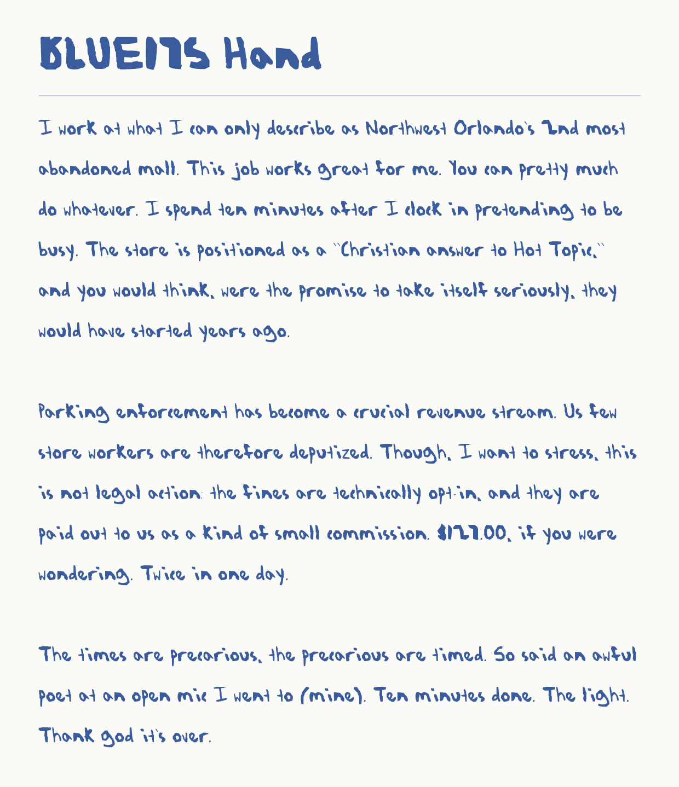

# GraphicNovelSans

BLUE175 Hand is a four-style handwriting font traced from the comic *BLUE175*, and GraphicNovelSans is the Python library that builds a TrueType and WOFF2 family from a hand-lettered sheet.

## Install and use the font

The desktop fonts are in [`blue175-hand/fonts/ttf/`](blue175-hand/fonts/ttf/). Install all four. They share the family name "BLUE175 Hand", so bold and italic come from the bold and italic controls. An application that was already open may list the name and still draw another face; restart it.

| File | Style |
|---|---|
| [`BLUE175.ttf`](blue175-hand/fonts/ttf/BLUE175.ttf) | Regular |
| [`BLUE175-Bold.ttf`](blue175-hand/fonts/ttf/BLUE175-Bold.ttf) | Bold |
| [`BLUE175-Italic.ttf`](blue175-hand/fonts/ttf/BLUE175-Italic.ttf) | Italic |
| [`BLUE175-BoldItalic.ttf`](blue175-hand/fonts/ttf/BLUE175-BoldItalic.ttf) | Bold Italic |

On macOS, copy the files into `~/Library/Fonts/`. On Linux, copy them into `~/.local/share/fonts/` and run `fc-cache -f`. On Windows, select the files, right-click, and choose Install.

[`blue175-hand/fonts/editor.html`](blue175-hand/fonts/editor.html) opens in a browser and checks whether the installed family is the one being drawn. It does not load the font files itself.

The same four styles are in [`blue175-hand/fonts/woff2/`](blue175-hand/fonts/woff2/) for the web. The `url()` paths below are relative to `blue175-hand/fonts/`:

```css
@font-face { font-family: "BLUE175 Hand"; src: url("woff2/BLUE175.woff2") format("woff2");
             font-weight: 400; font-style: normal; font-display: swap; }
@font-face { font-family: "BLUE175 Hand"; src: url("woff2/BLUE175-Bold.woff2") format("woff2");
             font-weight: 700; font-style: normal; font-display: swap; }
@font-face { font-family: "BLUE175 Hand"; src: url("woff2/BLUE175-Italic.woff2") format("woff2");
             font-weight: 400; font-style: italic; font-display: swap; }
@font-face { font-family: "BLUE175 Hand"; src: url("woff2/BLUE175-BoldItalic.woff2") format("woff2");
             font-weight: 700; font-style: italic; font-display: swap; }
```

## Specimen



## Character coverage

The font has 75 characters: `A-Z`, `a-z`, `0-9`, space, and `. , ; : - ? ! ' " ( ) $`. Anything else falls through to the next font.

Five digits are the same shapes as letters. `5` is drawn as `S`, `8` reads as `b`, `3` reads like `B`, `1` is the same stroke as `l` and `I`, and `0` and `O` are each one closed loop. Prose is fine. A string of digits wants another face.

How the glyphs were chosen, how the italic is cut, and the legibility reads are in [blue175-hand/README.md](blue175-hand/README.md).

## Build a font from a sheet

The `graphicnovelsans` package is not on PyPI. Install it from this repository. Python 3.8 or newer:

```bash
git clone https://github.com/pinklightultra/GraphicNovelSans.git
cd GraphicNovelSans
python -m pip install -e .
```

Make a sheet, draw in the cells, and build:

```bash
graphicnovelsans template --output my_template.png
graphicnovelsans build my_template.png -n "My Comic Hand" -d "Your Name"
```

`template` writes a 2480×3508 PNG (A4 at 300 DPI) with light-blue guide characters, a cell grid, and a baseline and an x-height line in each cell. The cells are `A-Z`, `a-z`, `0-9`, and `. , : ; ' " ( ) - ! ? $`. `--all-caps` writes an uppercase-only sheet.

`build` reads a PNG, JPG, or WebP. The default `--ink-mode` is `blue_pencil_drop`, which keeps dark ink and drops non-photo blue. It writes four styles to `./dist/`. Spaces are removed from the family name, and Regular has no style suffix:

```text
MyComicHand.ttf
MyComicHand-Bold.ttf
MyComicHand-Italic.ttf
MyComicHand-BoldItalic.ttf
```

Each style is also written as `.woff2`. A space glyph is added even when the sheet has no space cell.

If a cell is empty, `build` fills some characters from others: `)` from `(`, `q` from `p` (and the reverse), `"` from `'`, `;` from `.` and `,`, `:` from `.`, and `c/C`, `o/O`, `s/S`, `v/V`, `w/W`, `x/X`, `z/Z` from the other case. A missing `-` becomes a plain bar. Other missing characters are omitted.

This command does not rebuild the BLUE175 Hand files above. Those come from [`blue175-hand/pipeline/build.py`](blue175-hand/pipeline/build.py).

## Documentation

- [Installation](docs/installation.md)
- [Quickstart](docs/quickstart.md)
- [CLI reference](docs/cli-guide.md)
- [API reference](docs/api/index.md)
- [Troubleshooting](docs/troubleshooting.md)
- [Contributing](docs/contributing.md)

Changes are in [CHANGELOG.md](CHANGELOG.md).

## License

MIT, for the library and for the fonts. See [LICENSE](LICENSE) and [blue175-hand/LICENSE](blue175-hand/LICENSE).
