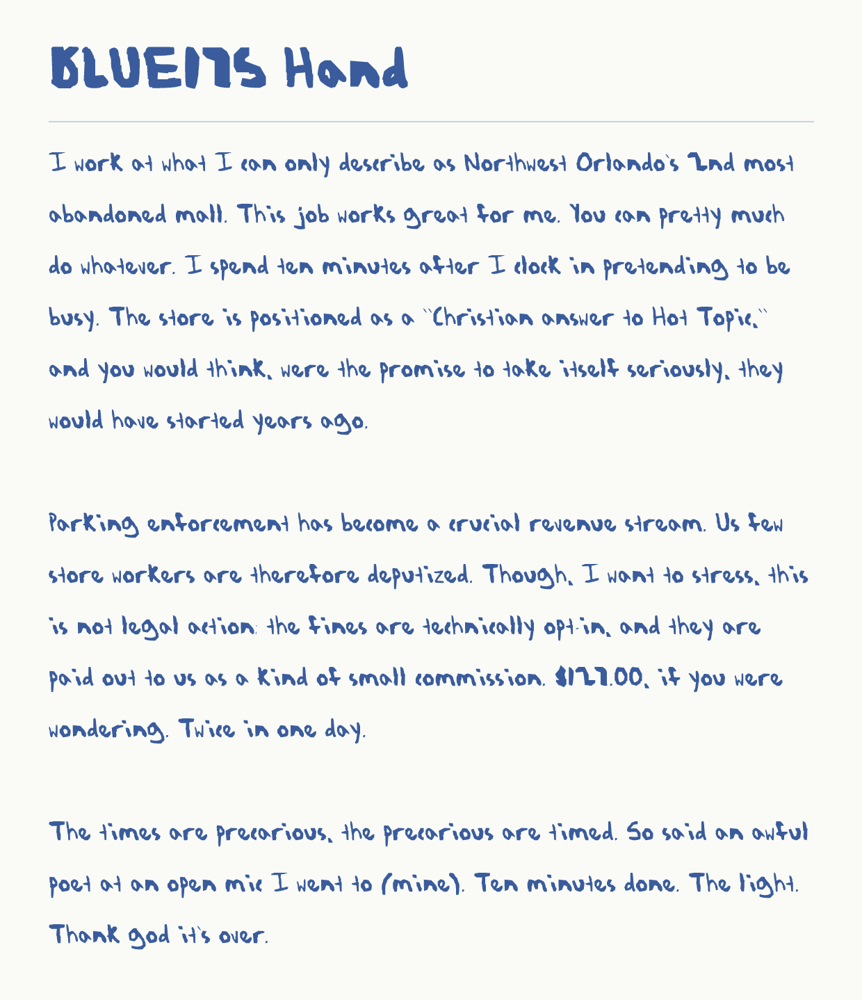

# GraphicNovelSans

GraphicNovelSans is a toolchain that turns hand-lettered drawings into a four-style font family, and a worked example of treating that font as a reading surface.

The Python library, `graphicnovelsans`, takes a lettering sheet or one drawing per character and builds Regular, Bold, Italic, and Bold Italic as TrueType and WOFF2. The styles share a family name, so the bold and italic controls select real files. [BLUE175 Hand](blue175-hand/) is the same pipeline run on the lettering in *BLUE175*, a fifteen-page comic by Justin Severn: each glyph is a piece of ink from those pages, and the finished face was read back under a key.

House voice is a type decision as well as a sentence decision. Comic lettering is a small, short-line surface. The pairs that collapse there (`I` / `l` / `1`, `O` / `0`, `S` / `5`) are the pairs that fail in UI strings, error text, captions, and docs set in a custom face. This repo is the content spec for one such face: which characters the hand can support, which characters were built from another glyph, which styles are separate cuts, and which strings belong in a different face.



The figure is the specimen: prose from the comic, typed in the finished Regular and wrapped on measured line length. It is the question the font was built to answer. Does a paragraph still read as sentences, and does it still look like the hand?

## The reading problem

A hand becomes a product font in one of two ways, and both drop information a reader needs.

A node editor (FontForge, Glyphs) asks for a Bézier at every corner and a kerning pair decided by eye. The lettering exists as control points. A writer cannot review it as text.

A grid tool asks the writer to letter inside a printed box. The hand's rhythm, baseline drift, and slant are cropped away. Bold and italic are then synthesized by the application: a thickened Regular floods the holes in `8`, `e`, `o`, and `B`, and a fixed slant on a backhand leaves a face that still looks upright. Any character the sheet omitted falls through to the next font in the stack, so one system `q` changes the voice of the sentence.

The library keeps the drawing as ink until the last step, derives the other three styles from that ink under stated rules, and writes the missing characters down as synthetic.

## From a drawing to a family

The library and the BLUE175 pipeline do the work in the same order. In BLUE175 a person chooses each piece of ink. In the library the lettering sheet chooses it, by cell.

**1. Keep the ink and drop the guides.**
`extract_ink_mask` has six modes. `comicfont build` accepts the first five.

| Mode | Use it when |
|---|---|
| `blue_pencil_drop` | The generated template, or black ink over non-photo blue. Default for `comicfont build`. |
| `black_on_white` | A scan or photo of dark ink on light paper. |
| `alpha` | A transparent export (Procreate, Clip Studio Paint, Photoshop). |
| `red_channel` | Light-blue ink on white. This is how the BLUE175 pages are separated. |
| `auto` | Alpha when the file has real transparency, otherwise black on white. |
| `white_on_black` | Light ink on a dark ground. Library only; the CLI does not offer it. |

The ghost letter is `#C3DCFF`. The grid and the baseline are lighter blues. `blue_pencil_drop` leaves those lines out and keeps dark ink.

**2. Address each character by the cell it was drawn in.**
Each character is the cell it occupies. The sheet is 13 columns. The full sheet is uppercase, lowercase, digits, and punctuation. `--all-caps` is the shorter sheet: uppercase, digits, and punctuation. The extractor scales the template margins from the reference size (2480 × 3508, A4 at 300 ppi), so a uniformly scaled export still maps. A photograph with perspective sends cells to the wrong characters; export the sheet flat, or scan it square. Pass the same `--all-caps` flag you used to generate the sheet. The wrong flag reads every cell as the wrong character. A cell is kept when it holds at least 15 ink pixels.

**3. Seat each glyph by character class.**
Handwriting jitters inside the cell. Placement ignores that jitter. Each character has a class height and a depth below the baseline (`a` at x-height, `b` and the capitals taller, `g` and `y` descending). The crop is scaled to its class, so one tall drawing cannot tilt the line. The em is 1000 units. x-height is 437, ascender 800, descender −220, cap height 700.

**4. Trace the ink and keep the corners.**
The mask is supersampled 4×, outlined, and simplified. A vertex stays on-curve when the turn is sharper than 52°, or when both adjoining edges are long. Gentler turns become the off-curve points of a quadratic curve. A nib corner stays a corner. Counters are wound as holes.

**5. Build a missing character from a named rule, and mark it synthetic.**
`build()` runs this before compiling. You can call `synthesize_missing()` yourself.

| Missing | Built from |
|---|---|
| `)` | `(` mirrored |
| `q` | `p` mirrored, or `p` from `q` |
| `z x c o v w s` and their capitals | the other case, copied |
| `"` | two copies of `'` |
| `;` | `.` stacked on `,` |
| `:` | `.` stacked on `.` |
| `-` | a plain bar, when no hyphen was drawn |
| `j` | the drawn `j` plus a dot taken from `.` |

The case copies are the same drawing. An all-caps sheet therefore gains `c o s v w x z` and still has no `a b d e f g h i j k l m n p q r t u y`. Use the full sheet when the face needs a lowercase.

If both `j` and `.` are present, a dot is stacked on `j` even when the drawing already has one. Draw `j` undotted, or leave `.` out until you want that rule.

**6. Cut Bold from the same ink, and keep the counters open.**
Bold adds 34 font units of stroke. That length is converted to source pixels per glyph, so a small `n` and a large capital thicken by the same typographic amount. The ink is dilated with a disc. Enclosed holes are shrunk back open, so `8`, `e`, `o`, `B`, and `a` stay legible. Weight class is 700.

**7. Cut Italic by measuring the hand.**
The italic angle on the font is −11°, an apparent forward lean of 11°. The shear applied to the outlines is `tan(11°) − measured slant`, where the slant is the median stem of the drawings. A hand that already leans backward needs more shear before a reader sees italic. On BLUE175 Hand the stems lean about 6° back, the outlines are sheared about 16°, and the face lands at that 11°. The hand never wrote a cursive italic. The Italic file is this shear, shipped as its own style, with `macStyle` and `fsSelection` set so the italic control selects it.

**8. Space each glyph from its own silhouette. Kern the pairs that are still wrong.**
Each outline is sliced into 40 horizontal bands. Sidebearings come from how far the ink sits inside its edges across the x-height, with a floor of 10 units. After that, ordinary pairs already have a gap.

Kerning looks at the tightest band the two glyphs share, which is where a collision would start:

- Closer than 52 units: push apart, up to 150 units.
- Farther than 200 units: tuck. The tuck is scaled by how much of the taller glyph actually faces its neighbor, and it never pulls the second glyph past the middle of the first, or past 300 units.
- Between 52 and 200: leave the pair alone.
- An adjustment smaller than 12 units is dropped.

A `T` can hold the next letter under its crossbar. `nn` stays at its sidebearings.

**9. Write four files, and write the kerning twice.**
Each style is a TrueType file and a WOFF2 file of the same font. Kerning is stored as an OpenType GPOS pair adjustment, and again as a legacy format-0 `kern` table, because a lot of desktop software reads only the second. The family name is shared. Filename spaces are removed: family `My Comic Hand` writes `MyComicHand.ttf`, `MyComicHand-Bold.ttf`, `MyComicHand-Italic.ttf`, and `MyComicHand-BoldItalic.ttf`, plus the four `.woff2` files.

Space is generated at 0.30 em. `.notdef` is empty, at the same width. A character outside the drawn set and the synthesis rules is absent from the cmap and falls through to the next face.

## Use it

Python 3.8 or newer. The install pulls in NumPy, Pillow, fontTools, uharfbuzz, and Brotli.

```bash
git clone https://github.com/pinklightultra/GraphicNovelSans.git
cd GraphicNovelSans
pip install -e ".[test]"
```

`pip install -e .` is enough if you only want the library. The `[test]` extra adds pytest. Either install provides the `comicfont` and `graphicnovelsans` commands; they are the same program.

### Read BLUE175 Hand before building anything

The four desktop fonts are already in [`blue175-hand/fonts/ttf/`](blue175-hand/fonts/ttf/). Install all four. The family name is `BLUE175 Hand`. An application that was open during the install may list the name and draw a substitute; restart it, then open [`blue175-hand/fonts/editor.html`](blue175-hand/fonts/editor.html). That page is editable and declares no `@font-face`. It measures one string twice, once in `BLUE175 Hand` and once in a family name that cannot exist, both with monospace as the fallback. A width difference, plus `document.fonts.check`, means the installed family is what you are reading. Equal widths mean the browser drew the fallback.

For the web, declare all four files under one family. [`blue175-hand/fonts/woff2/`](blue175-hand/fonts/woff2/) holds them.

```css
@font-face { font-family: "BLUE175 Hand"; src: url("woff2/BLUE175.woff2") format("woff2");
             font-weight: 400; font-style: normal; font-display: swap; }
@font-face { font-family: "BLUE175 Hand"; src: url("woff2/BLUE175-Bold.woff2") format("woff2");
             font-weight: 700; font-style: normal; font-display: swap; }
@font-face { font-family: "BLUE175 Hand"; src: url("woff2/BLUE175-Italic.woff2") format("woff2");
             font-weight: 400; font-style: italic; font-display: swap; }
@font-face { font-family: "BLUE175 Hand"; src: url("woff2/BLUE175-BoldItalic.woff2") format("woff2");
             font-weight: 700; font-style: italic; font-display: swap; }
```

Anything outside `A–Z a–z 0–9 . , ; : - ? ! ' " ( ) $` and space falls through. Prose in this face reads. Bare digit strings, account numbers, and phone numbers want a different face. The source ink makes `5` the same form as `S`, `8` a closed shape a reader takes for `b`, `3` close to `B`, `1` a bare stroke shared with `l` and `I`, and `0` a closed loop shared with `O`. That list is the usage note.

### Build a face from a sheet

Generate the full sheet (both cases):

```bash
comicfont template --output lettering_sheet.png --title "Northwind Hand"
```

Add `--all-caps` for the shorter sheet. Open the PNG, or print it, and draw each character in dark ink in its own cell. The light blue guides are discarded.

```bash
comicfont build lettering_sheet.png \
  --name "Northwind Hand" \
  --designer "Your Name" \
  --out ./dist
```

A paper scan wants `--ink-mode black_on_white`. A transparent drawing wants `--ink-mode alpha`. The command prints how many cells had ink, which characters were synthesized, and the kern-pair count of each style. The count is whatever those drawings produce.

### From Python

```python
from graphicnovelsans import ComicFont

font = ComicFont(family_name="Northwind Hand", designer="Your Name")
font.load_lettering_sheet("lettering_sheet.png")  # all_caps=True if you used that sheet
# or one crop at a time: font.add_glyph("A", "A.png")
font.build(output_dir="./dist")
```

`build()` synthesizes missing glyphs unless you pass `auto_synthesize=False`. `styles` defaults to all four; pass a subset to compile fewer.

### Examples

| Script | What it does |
|---|---|
| [`examples/quickstart.py`](examples/quickstart.py) | Builds a four-style family from letters drawn with DejaVu, one tile at a time. A stand-in for a hand, so you can see the API move. |
| [`examples/lettering_sheet_harvest.py`](examples/lettering_sheet_harvest.py) | Writes a template, fills the cells with DejaVu, extracts them, and compiles. |
| [`examples/comic_panel_demo.py`](examples/comic_panel_demo.py) | Sets BLUE175 dialogue in three balloons with HarfBuzz, so the kerning on screen is the kerning in the file. Each line is drawn at a fixed size. A line longer than the balloon continues past the border. |

## BLUE175 Hand

The package README, [blue175-hand/README.md](blue175-hand/README.md), is the full method. The short version:

The font has 75 characters, the set listed above. 67 are cut from the comic's ink. Seven exist because the pages have no clean instance: `X` and `z` are copies, `q` and `)` are mirrors, `"` is a pair of quotes, `;` is a stack, and `j` gains a dot. Space is the remaining character. No third-party font is a source. `data/picks.json` records which ink on which page became which character, and a rebuild cuts that ink from the page again.

The pages are not in this repo. To rebuild, point `BLUE175_PAGES` at a folder of `p01.webp` through `p15.webp` (1600 × 2129):

```bash
cd blue175-hand
pip install -r requirements.txt
BLUE175_PAGES=/path/to/pages python pipeline/build.py   # writes out/
```

On a fresh clone, with no pages, the proof and the score still run against the committed fonts and the committed reads:

```bash
cd blue175-hand
python pipeline/specimen.py
python pipeline/score.py ship_read1.json
```

### How it was read

`legibility/blindtest.png` is a 15-line sheet: sentences, pangrams, random syllables, and the pairs a hand tends to collapse, with the last lines in Bold, Italic, and Bold Italic. Six readers transcribed it. Each reader was a Claude vision session given the image and no other file. Character error rate is Levenshtein distance over the 598 characters of the key.

| Read | Errors | CER |
|---|---:|---:|
| `final_indep2` | 17 | 2.84% |
| `final_indep3` | 25 | 4.18% |
| `final_indep1`, `ship_read2` | 26 | 4.35% |
| `ship_read1`, `ship_read3` | 27 | 4.52% |
| **Pooled** | **148 / 3,588** | **4.12%** |

The table is the regression lock for that sheet: [`tests/test_legibility.py`](blue175-hand/tests/test_legibility.py) fails if a recorded read scores differently, and it fails if the sheet no longer regenerates pixel for pixel from the shipped fonts. The reads were taken before the final build, so that pixel check is what ties the score to the files in the repo.

`pipeline/score.py` also prints which character was read as which. A rate concentrated on one pair, such as `S`/`5`, is a different content decision from the same rate spread across the alphabet. Digit-only A/B sheets live in `pipeline/ab.py` and `pipeline/solo.py`. Quote those rates for the digit sheets they measure. The 15-line sheet above is a separate result.

The pipeline directory is the review trail: candidate contact sheets (`candsheet.py`, `picksheet.py`), the cut a manifest entry actually makes (`probe.py`), band kerning (`kern.py`), HarfBuzz proofs (`render.py`, `proof.py`, `specimen.py`), and the blind sheet (`blindsheet.py`).

## Tests

From the repository root, `pytest` collects both suites. The library tests check ink extraction (black on white, alpha, blue-pencil drop), template generation and cell extraction, the synthesis rules, and an end-to-end build: four styles with family name and style name set, `glyf`, `cmap`, a GPOS table when the style has kerning, a `kern` table, and a WOFF2 with the same glyph order.

The BLUE175 tests check the shipped fonts: family name, style linking, charset, the legacy kern counts (Regular 718, Bold 639, Italic 877, Bold Italic 730), a GPOS pair-adjustment lookup, and WOFF2 tables that compile equal to the TrueType tables for `glyf`, `hmtx`, `cmap`, `GPOS`, `kern`, `name`, and `OS/2`. They also check band kerning, red-channel ink separation, HarfBuzz advances, and the recorded error counts. Four tests rebuild every style from the source pages and compare tables. They skip unless `BLUE175_PAGES` is set.

```bash
pytest
```

[`.github/workflows/test.yml`](.github/workflows/test.yml) runs that command on Ubuntu for Python 3.10, 3.11, and 3.12, on pushes and pull requests to `main` and `master`.

[`blue175-hand/.github/workflows/tests.yml`](blue175-hand/.github/workflows/tests.yml) is the workflow from when that directory stood alone: Ubuntu and Windows, Python 3.10 through 3.13, warnings treated as errors. GitHub Actions runs the workflows in the repository-root `.github/workflows` directory. The nested file is the standalone command; the root workflow is the one that runs on this repo. To run the font suite the way that file describes:

```bash
cd blue175-hand
python -m pip install pytest -r requirements.txt
python -W error -m pytest
```

## Layout

```
graphicnovelsans/     library: ingest, template, trace, synthesis, bold, italic, kern, build
tests/                library tests
examples/             API demo, sheet harvest, balloon typesetting
blue175-hand/         BLUE175 Hand fonts, picks, legibility reads, pipeline, tests
```

## License

MIT, for the library and for the fonts. Copyright 2026 Justin Severn.
